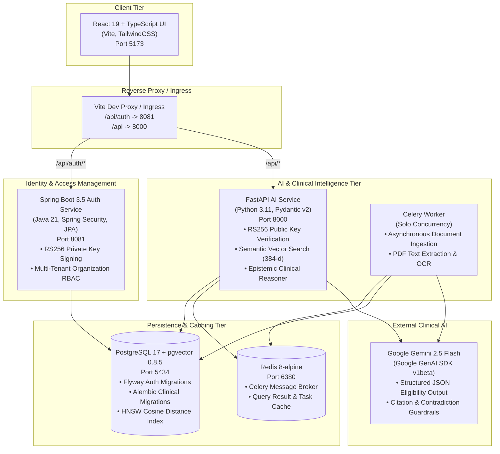

# MedMatch V2 — AI-Powered Clinical Trial Matching Engine

MedMatch V2 is an enterprise-grade, multi-tenant clinical trial prescreening and eligibility matching platform. It bridges oncology patient clinical notes with trial eligibility criteria using dense vector retrieval (pgvector) and three-valued epistemic reasoning (MET, NOT_MET, UNKNOWN) powered by large language models.

---

## 1. Architecture Overview



---

## 2. Technology Stack

| Layer | Technologies |
|---|---|
| **Frontend** | React 19, TypeScript, Vite, TailwindCSS, Lucide Icons, Axios |
| **Authentication Service** | Java 21, Spring Boot 3.5, Spring Security, Nimbus JOSE (RS256 JWT), Hibernate, Flyway |
| **AI Matching Service** | Python 3.11, FastAPI, Pydantic Settings v2, SQLAlchemy 2.0, Alembic, Celery |
| **Retrieval & Embeddings** | `sentence-transformers/all-MiniLM-L6-v2` (384 dimensions), pgvector 0.8.5 |
| **LLM Reasoning** | Google Gemini 2.5 Flash (`google-genai` SDK v1beta, structured JSON mode) |
| **Datastores** | PostgreSQL 17 (pgvector enabled), Redis 8-alpine |
| **Containerization** | Docker, Docker Compose v2, Kubernetes manifests (Namespace, Deployment, PVC) |

---

## 3. Key Capabilities & Safety Features

1. **Epistemic Tri-State Logic (MET, NOT_MET, UNKNOWN):**
   Unlike binary classifiers that hallucinate eligibility on incomplete patient charts, MedMatch uses Kleene three-valued epistemic logic. When genomic biomarkers or lab values are absent from the patient note, criteria evaluate to `UNKNOWN` and route to `NEEDS_REVIEW`.
2. **Hard-Exclusion Precedence:**
   High semantic similarity can never override an explicit clinical exclusion criterion. Any `NOT_MET` exclusion immediately disqualifies the trial regardless of embedding proximity.
3. **Cryptographic Tenant Isolation:**
   Authentication tokens are signed with asymmetric RS256 private keys in the Auth Service. The AI Service validates signatures using the public key and strictly scopes patient records and match tasks by `hospital_id`.
4. **Adversarial & Injection Defenses:**
   Uploads are validated via MIME magic byte signatures (`%PDF-`), and prompts encapsulate untrusted text in strict delimiters with JSON schema validation.

---

## 4. Local Quickstart (Docker Compose)

### Prerequisites
- Docker Desktop with Docker Compose v2
- Java 21 & Maven 3.9+ (optional for local host builds)
- Python 3.11+ (optional for local virtual environment)
- Node.js 20+ (optional for standalone UI dev)

### 1. Environment Configuration
Copy the template environment file:
```bash
cp .env.example .env
```
Ensure required variables are populated with your configuration:
```ini
GOOGLE_API_KEY=your_gemini_api_key_here
DATABASE_PASSWORD=postgres
REDIS_PASSWORD=
```

### 2. Launch the Platform
```bash
docker compose up -d --build
```

Verify service status:
```bash
docker compose ps
```

All 6 services will start with automated health probes:
- Frontend: `http://localhost:5173`
- FastAPI AI Service: `http://localhost:8000` (`/docs` for OpenAPI Swagger)
- Spring Boot Auth: `http://localhost:8081` (`/actuator/health` for Actuator)
- PostgreSQL: `localhost:5434`
- Redis: `localhost:6380`
- Celery Worker: Running in background

---

## 5. Automated Test Suite Execution

MedMatch V2 maintains **246 unique automated tests** with 100% pass reproducibility.

### Spring Boot Auth Service (85 Tests)
```bash
cd services/auth-service
mvn test
```

### FastAPI AI Service (116 Tests)
```bash
cd services/ai-service
.venv\Scripts\python -m pytest tests -v
```

### Integration & Security Suites (38 Tests)
```bash
pytest tests/integration tests/security -v
```

### Reliability & Fault-Tolerance Suite (7 Tests)
```bash
pytest tests/reliability/test_live_reliability.py -v
```

### Frontend Build & Lint
```bash
cd frontend/medmatch-ui
npm run build
npm run lint
```

---

## 6. End-to-End Clinical Demonstration Flow

1. **Sign In:** Log in as a Clinical Research Coordinator (`research@hospital.org`).
2. **Ingest Trial Protocol:** Upload an oncology clinical trial protocol PDF (e.g., Phase III NSCLC Osimertinib). Celery extracts text and indexes 384-dimensional criterion embeddings in pgvector.
3. **Upload Patient Chart:** Submit an unstructured clinical discharge summary or pathology report.
4. **Dense Vector Search:** Fast cosine search retrieves top-k candidate trials within milliseconds.
5. **Epistemic LLM Reasoning:** Gemini 2.5 evaluates each criterion into `MET`, `NOT_MET`, or `UNKNOWN` with verbatim patient note citations.
6. **Coordinator Review:** Coordinator reviews matches on the interactive Evaluation Dashboard (`/evaluation-dashboard`).

---

## 7. Compliance & Clinical Limitations Disclaimer

> [!WARNING]
> **RESEARCH PROTOTYPE & ENGINEERING DEMONSTRATION ONLY**
>
> MedMatch V2 is currently cleared solely for engineering demonstration and synthetic research evaluation.
> - **Not an FDA-Approved Medical Device:** MedMatch does not provide medical advice, diagnosis, or definitive clinical trial enrollment decisions.
> - **Synthetic Benchmark Validation:** All reported performance figures (100% accuracy, 0% false positives) are established on verified synthetic oncology benchmarks. Clinical validation on real-world electronic health record (EHR) cohorts remains pending.
> - **HIPAA / PHI Notice:** Do not upload real Protected Health Information (PHI) to this deployment. A signed Google Cloud HIPAA Business Associate Agreement (BAA) and Vertex AI private VPC endpoints are mandatory before processing live clinical records.
